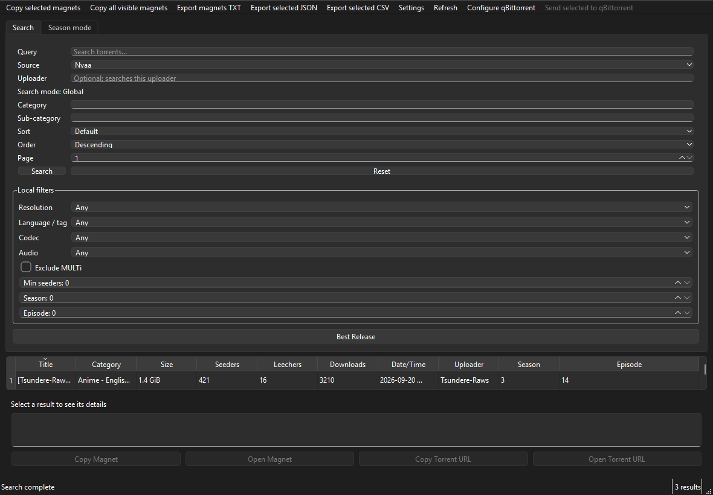

# NyaaAPI GUI

**NyaaAPI GUI** is a Windows-friendly desktop application for searching the unofficial Nyaa API. It uses the [`nyaaapi-client`](https://github.com/Trycky64/nyaaapi-client) library for every API request; it does not scrape `nyaa.si` or implement HTTP calls of its own.



## Features

- Search Nyaa or Sukebei, globally or by uploader, with query, category, sub-category, sort and page controls.
- Keep searches responsive while requests run in Qt's thread pool.
- Sort and select results, inspect complete details on demand, copy/open magnet links and torrent URLs.
- Filter fetched results locally by resolution, language/tag, codec, audio, MULTi status, seeders, season and episode.
- Parse common anime release titles, rank a Best Release, and compare a season against a user-selected episode range. Missing episode numbers describe the current results only; the app does not assume a season has finished.
- Copy or export magnets and selected torrent metadata as TXT, JSON or CSV.
- Optionally send selected magnets to a qBittorrent Web API instance. qBittorrent is not required; its password remains in memory for the current session and is never stored by the app.
- Remember search preferences with `QSettings`; keep recent searches and details in a bounded in-memory cache.

## Requirements

- Python 3.11 or newer
- Windows, Linux or macOS with a Qt desktop environment
- `nyaaapi-client` v0.1.0 (installed from its GitHub tag)

## Install and launch

```powershell
python -m pip install nyaaapi-gui
nyaaapi-gui
```

Or launch the module:

```powershell
python -m nyaaapi_gui
```

For local development:

```powershell
git clone https://github.com/Trycky64/nyaaapi-gui.git
cd nyaaapi-gui
python -m pip install -e ".[dev]"
python -m nyaaapi_gui
```

The optional release tools are installed separately:

```powershell
python -m pip install -e ".[release]"
```

## Search examples

Choose **Nyaa** or **Sukebei**, enter a query such as `Mushoku Tensei`, then press **Search**. Add an uploader such as `Tsundere-Raws` to search that user's uploads while keeping the query and other API filters.

Local filters operate on the results already returned, so changing a resolution or language does not send another API request. Season mode accepts an anime, season, optional uploader, release preferences and an episode interval such as E01–E24. The episode count is the number currently found within that interval.

Use **Best Release** to rank currently matching rows. The ranking prefers the configured resolution and language, can avoid MULTi, then compares seeders, downloads and release-group consistency.

Select one or more rows to copy magnets or export JSON/CSV. **Copy all visible magnets** and TXT export use the current table order. Season results are ordered by episode.

## qBittorrent (optional)

Install the `release` extra, open **Configure qBittorrent**, and provide its Web API host, port, username, password and optional save path. The password field is masked and is not written to `QSettings`. Select results and choose **Send selected to qBittorrent**. The app never sends a torrent before the user invokes this action.

In Season mode, use **Send season to qBittorrent** to add all currently found episodes in episode order.

## Settings and shortcuts

The Settings dialog remembers the default source, preferred resolution and language, MULTi and seeders filters, favorite uploader, maximum pages and API timeout. **Reset Defaults** restores the initial preferences.

- `Ctrl+F`: focus the search query
- `Enter`: submit a search from the query field
- `Ctrl+C`: copy selected magnets, or the selected title when there is no row selection
- `Esc`: clear the search form when idle

## Development and tests

```powershell
python -m pip install -e ".[dev]"
python -m ruff check .
python -m mypy src
python -m pytest -q
python -m build
```

The unit suite uses mocks and does not contact the remote API. An opt-in live smoke test can be enabled with `NYAAGUI_RUN_INTEGRATION=1 python -m pytest -q -m integration`. Qt tests run headlessly with `QT_QPA_PLATFORM=offscreen` on CI. Coverage is required to stay at or above 90%.

See [docs/building-windows.md](docs/building-windows.md) for creating the portable Windows build and [docs/architecture.md](docs/architecture.md) for the package boundaries.

## Limitations and API notice

Nyaa-API is unofficial, independently operated and may change, return incomplete data or be unavailable. Search filters, pagination and torrent metadata follow the `nyaaapi-client` v0.1.0 contract. Anime parsing is best-effort and works on release-title text; it cannot infer an episode number that a release title omits. Season completeness depends on the pages and results returned at search time.

This project only finds and opens links. It contains no BitTorrent engine, does not scrape Nyaa directly, and has no user account or cloud synchronization.

## License

MIT. See [LICENSE](LICENSE).
